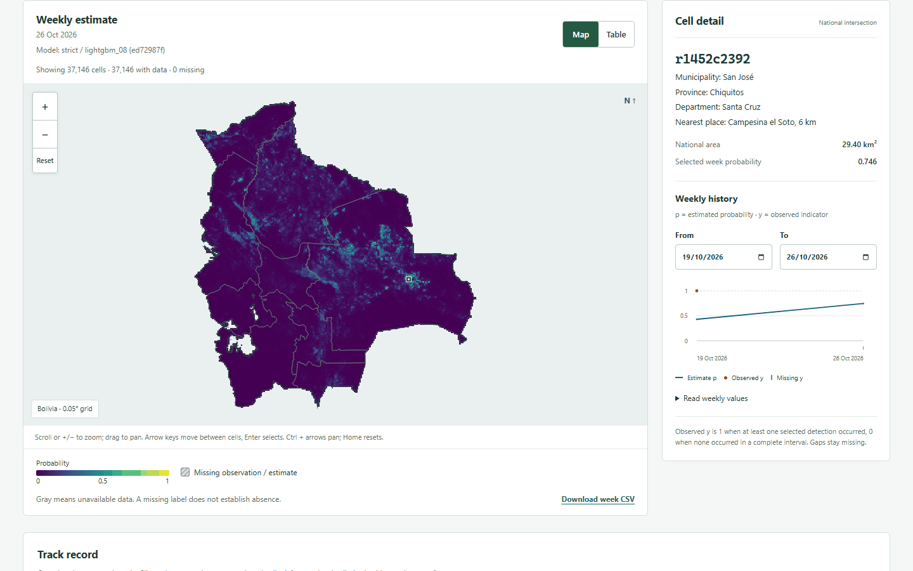
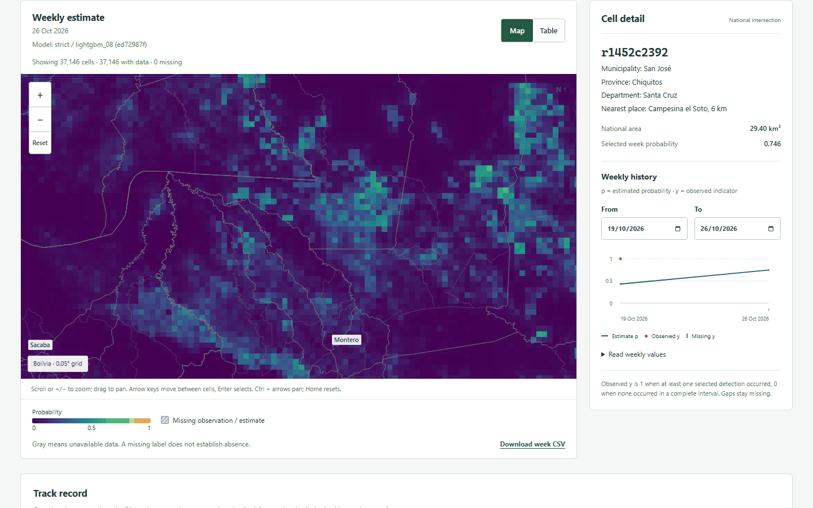
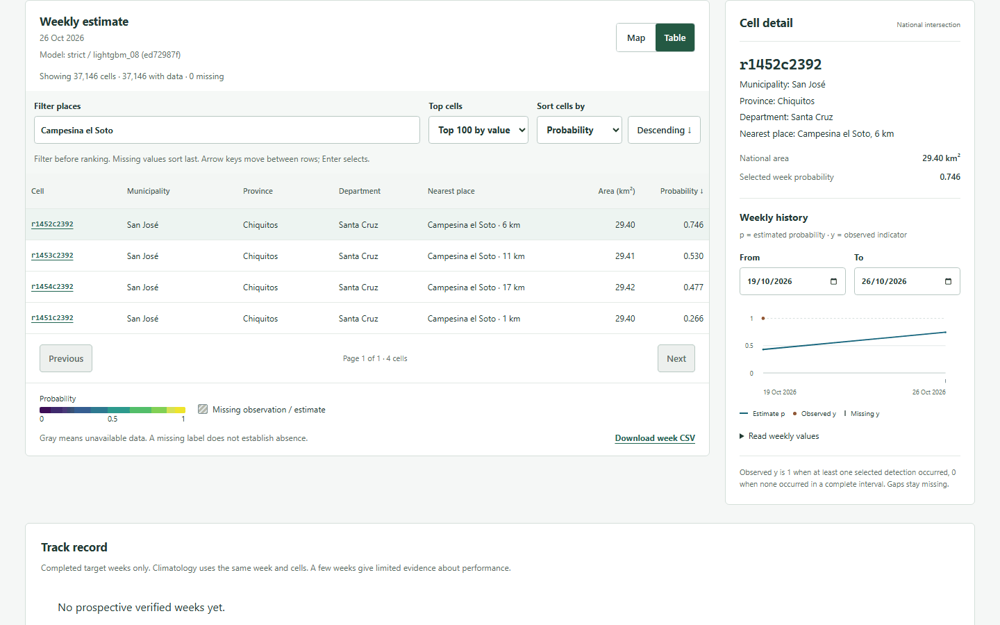
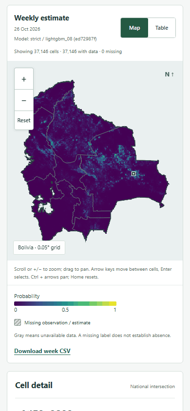
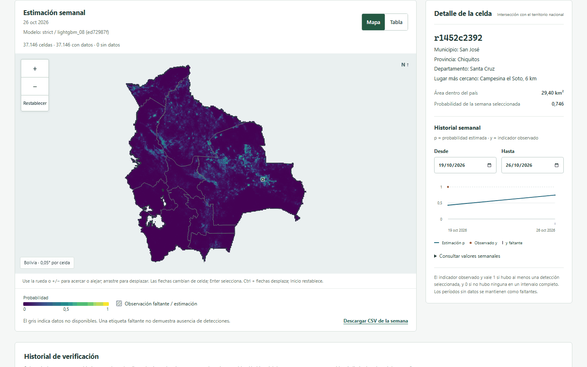
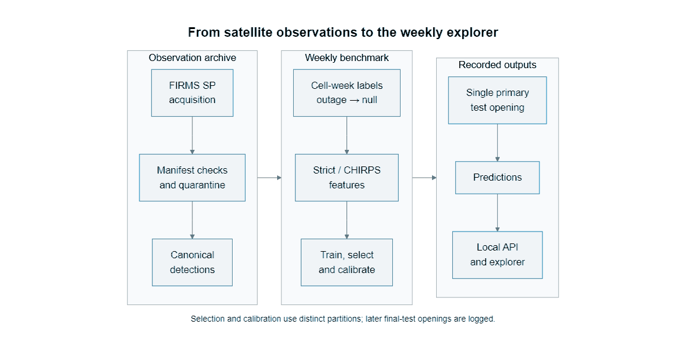

# Bolivia Fire

**English** · [Español](README.es.md)

Bolivia Fire builds a reproducible weekly dataset and evaluation pipeline for satellite
fire detections in Bolivia. The [live explorer](https://bolivia-fire.cupesi.org) shows an
experimental weekly estimate from near-real-time data; the local API explores the historical
benchmark. The target is at least one selected NASA FIRMS VIIRS S-NPP detection in the national
part of a 0.05° cell during the seven days beginning Monday 00:00 UTC.

The calibrated strict LightGBM achieves temporal-test AP 0.323393
(95% CI [0.221655, 0.382973]). H1 is supported: the paired AP gain over the validation-selected,
uncalibrated climatology baseline has 95% CI [0.099838, 0.217886]. H2 meets the frozen rule because
the retrospective-minus-strict AP interval [-0.004107, 0.001889] contains zero; this is not an
equivalence test. Geographic-holdout AP is 0.383912 (95% CI [0.250128, 0.467940]).
See [results and sensitivity analyses](docs/results.md), the source
[evaluation](artifacts/evaluation/test_strict.json), and the
[post-hoc learner comparison](docs/model-comparison.md), which retains the published LightGBM
model and reports exploratory results separately.

The target describes satellite detections, not numbers of fires, ignitions, burned area or an
official warning. Complete negative labels mean no selected detection was observed; incomplete
target weeks have null labels. See the [dataset card](datasets/dataset_card.md).

## Screenshots



Weekly estimate for issue 2026-10-26, with the national grid, probability scale and selected
San José cell history. Place details identify municipality, province, department and nearest place.



Zoomed estimate map with administrative outlines and town labels, alongside the selected cell's
place details and weekly history.

<details>
<summary>Table, mobile and Spanish views</summary>



Estimate table filtered to Campesina el Soto, showing municipality, province, department,
nearest place, national area and probability, alongside the selected cell history.



The 390 × 844 mobile view shows the national estimate map, issue date, model and probability legend.



Spanish interface for issue 2026-10-26 with the same national estimates and selected cell details.
The interface supports English and Spanish.

</details>

## How it works



The stages follow the frozen [protocol](configs/protocol.yaml): validate FIRMS standard-processing
observations, build labels and features, select and calibrate on validation years, and record test
predictions and metrics. The [live pipeline](docs/live.md) applies the frozen model to pre-issue
near-real-time inputs and keeps backfills separate from prospective scores.

Historical maps combine temporal `strict` estimates with `strict_geo` estimates for held-out cells.
Thin purple outlines mark the held-out blocks; cell details identify the model producing each
value. Unavailable geographic estimates have a separate legend entry.

## Installation

Use Python 3.12 or newer and [uv](https://docs.astral.sh/uv/). From the repository root:

```powershell
uv sync --all-extras
uv run --no-sync bolivia-fire --help
```

The browser frontend requires Node 22.12 or newer and npm:

```powershell
cd frontend
npm ci
npm run check
npm run test
npm run build
cd ..
```

## Commands and reproduction

These interface and offline checks do not acquire source data or change fitted models:

```powershell
uv run --no-sync bolivia-fire build --help
uv run --no-sync bolivia-fire train --help
uv run --no-sync bolivia-fire select --help
uv run --no-sync bolivia-fire evaluate --help
uv run --no-sync bolivia-fire predict --help
uv run --no-sync bolivia-fire compare --help
uv run --no-sync bolivia-fire live --help
uv run --no-sync python -m backend.app.prepare --help
uv run --no-sync pytest tests backend/tests -m "not live and not local_data" -q -p no:cacheprovider
```

The [reproduction guide](docs/reproduction.md) gives acquisition, dataset construction, rainfall
extraction, training, validation selection, final-test access, prediction export and API/UI startup
in order. The four notebooks cover [exploration](notebooks/01_exploration.ipynb),
[features](notebooks/02_features.ipynb), [modeling](notebooks/03_modeling.ipynb) and
[evaluation](notebooks/04_evaluation.ipynb). The [documentation index](docs/index.md) links contracts,
[static hosting](docs/frontend.md#static-hosting) and resource measurements.

## Data access

Obtain a NASA FIRMS map key, copy [.env.example](.env.example) to `.env`, and set `FIRMS_MAP_KEY`
locally; an environment variable takes precedence. Keep the key and credential-bearing URLs out
of logs and source control. Source pins and attribution cover FIRMS, geoBoundaries, GeoNames and
CHIRPS in [datasets/sources.yaml](datasets/sources.yaml). MapBiomas was omitted after verified
anonymous raster requests failed; the fitted retrospective model uses CHIRPS rainfall inputs.

Git contains manifests, source pins, schemas, licence notes and descriptive summaries. Raw
snapshots, intermediate bundles, processed datasets, model binaries and prediction Parquet files
are local generated artifacts. Manifests record retrieval identity and hashes, without the source
observations. See [dataset storage and rebuilding](datasets/README.md).

## Limitations

- Clouds, smoke, overpass timing, small fires and sensor outages affect detection; zero does not
  establish absence of fire. The outage rule does not establish cloud-free coverage.
- Cells are not equal-area. Area budgets use geodesic national intersections; the pinned ADM0
  excludes large interior salt flats and lakes.
- SP-to-NRT equivalence has not been validated. NRT lacks a source-type field; the live filter uses
  a static-source mask that approximates the SP vegetation-source filter.
- Training climatology uses other training years, including later years, under the frozen
  cross-fitting rule. Held-out labels never enter fitting or selection. CHIRPS v3 historical
  vintages are retrospective.
- Live backfills are separate from prospective performance. A short track record does not
  establish reliability; incomplete target weeks remain unscored.

## Licence and citation

Code is [MIT licensed](LICENSE). Data retain their source-specific terms:
[FIRMS](datasets/licenses/FIRMS.md), [geoBoundaries](datasets/licenses/geoBoundaries.md),
[GeoNames](datasets/licenses/GeoNames.md), [CHIRPS](datasets/licenses/CHIRPS.md),
[MapBiomas](datasets/licenses/MapBiomas.md) and the [dataset card](datasets/dataset_card.md).
The pinned geoBoundaries gbOpen BOL ADM0/ADM1 releases at revision `9469f09` report
`boundaryLicense: Public Domain`. Retain GeoBolivia, geoBoundaries and Runfola et al. (2020)
attribution. GeoNames place names use CC BY 4.0. CHIRPS v3.0 final daily `rnl` uses CC BY 4.0
with the provider's stated waiver; credit Climate Hazards Center and CHIRPS3 Data Repository
(2025), ERA5 disaggregation, cell-center mapping and antecedent-rainfall aggregation.
Use [CITATION.cff](CITATION.cff) to cite the software and retain source attributions when
redistributing derived data.

Bolivia Fire is maintained by Victor Hugo Cuellar Flores and hosted by the Cupesí Labs open-source organization.
