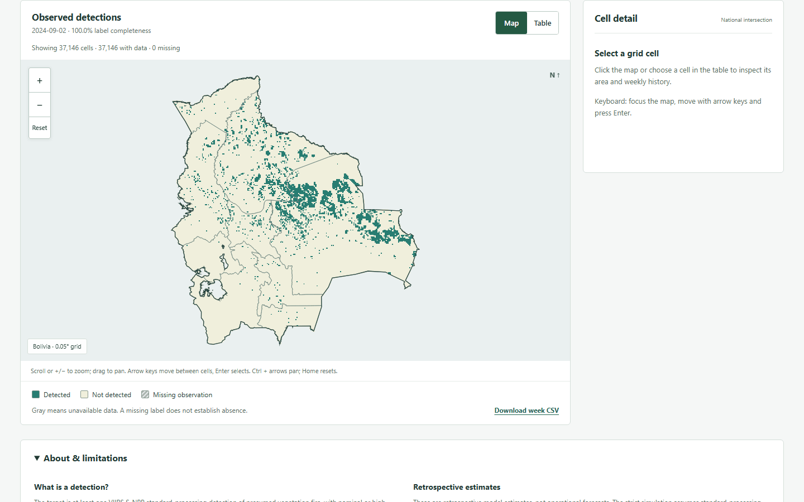
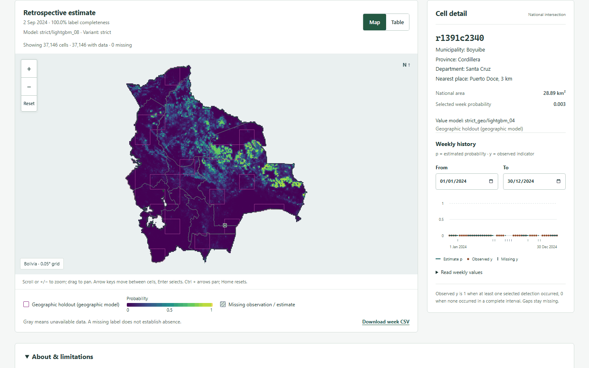
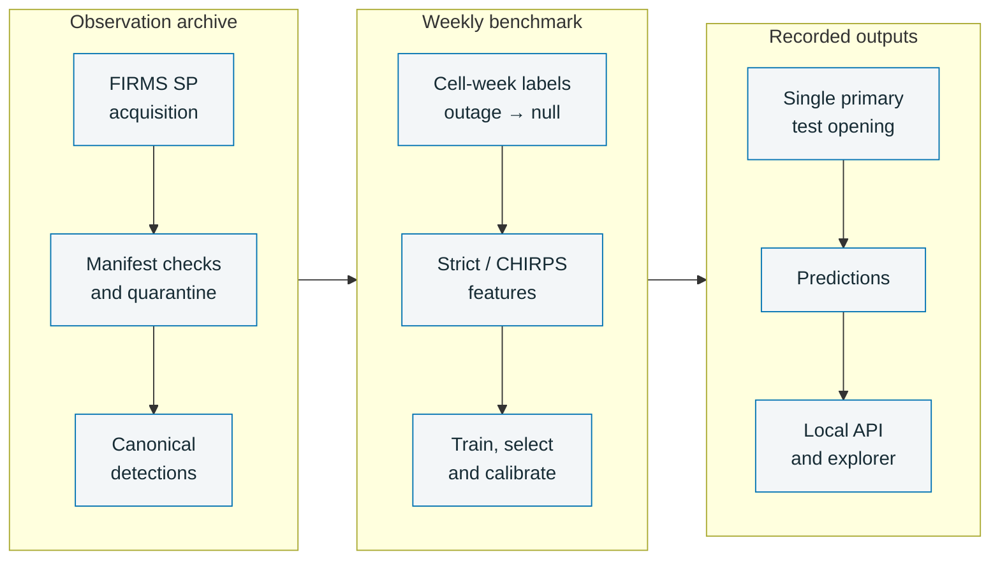

# Bolivia Fire

Bolivia Fire builds a reproducible weekly dataset and evaluation pipeline for satellite fire
detections in Bolivia, with a local API and browser explorer. It estimates the probability of at
least one selected NASA FIRMS VIIRS S-NPP standard-processing detection in the national part of a
0.05° cell during the seven days beginning Monday 00:00 UTC.

Status: the dataset, pipeline, API and browser UI are complete; all pre-registered
[sensitivity analyses](docs/results.md#sensitivity-analyses) are published as logged reopenings
in the [final-test access log](artifacts/evaluation/final_test_log.json).

The calibrated strict LightGBM achieves temporal-test AP 0.323393
(95% CI [0.221655, 0.382973]). H1 is supported:
the paired AP gain over the validation-selected, uncalibrated climatology baseline has 95% CI
[0.099838, 0.217886]. H2 meets the frozen rule because the retrospective-minus-strict AP interval
[-0.004107, 0.001889] contains zero; this is not an equivalence test. Geographic-holdout AP is
0.383912 (95% CI [0.250128, 0.467940]);
see [results](docs/results.md) and the source [evaluation](artifacts/evaluation/test_strict.json).

The target describes satellite detections, not numbers of fires, ignitions, burned area or an
official warning. A complete negative label means no selected detection was observed; incomplete
target weeks have null labels. See the [dataset card](datasets/dataset_card.md).

## Screenshots

These captures use the local API and recorded artifacts for issue **2024-09-02**.



Observed positive and negative cells for the complete seven-day target, from the prepared panel.



The calibrated `strict/lightgbm_08` estimate and selected Santa Cruz cell history come from the strict prediction export and panel observations.

<details>
<summary>Table and mobile views</summary>


The table exposes the same API layer values as the map, with selected-cell history alongside.


The 390 × 844 mobile capture shows the same issue, model, missing-value legend and national grid.

</details>

## How it works


The highlighted stages follow the frozen [protocol](configs/protocol.yaml), from FIRMS standard-processing acquisition to the local API and explorer.

<details>
<summary>Workflow source</summary>



</details>

## Installation

Use Python 3.12 or newer and [uv](https://docs.astral.sh/uv/). From the repository root:

```powershell
uv sync --all-extras
uv run bolivia-fire --help
```

The optional browser frontend requires Node 22.12 or newer and npm:

```powershell
cd frontend
npm ci
npm run check
npm run test
npm run build
cd ..
```

## Commands and reproduction

These checks run without acquiring source data or changing fitted models:

```powershell
uv run bolivia-fire acquire firms --start 2012-01-20 --end 2026-01-04 --dry-run --max-partitions 1
uv run bolivia-fire build cells --help
uv run bolivia-fire build detections --help
uv run bolivia-fire build panel --help
uv run bolivia-fire train --help
uv run bolivia-fire select --help
uv run bolivia-fire evaluate --help
uv run bolivia-fire predict --help
uv run bolivia-fire covariates chirps-annual --help
uv run bolivia-fire covariates features --help
uv run python -m backend.app.prepare --help
uv run uvicorn backend.app.main:app --help
uv run pytest -q
uv run pytest -q backend/tests -p no:cacheprovider
```

The [reproduction guide](docs/reproduction.md) gives acquisition, builds, rainfall extraction,
training, validation selection, the explicit final-test opening, prediction export and API/UI
startup in order. Interface checks above do not establish production model results. Start with
the [documentation index](docs/index.md) for individual contracts and measured resource use.

## Data access

Obtain a NASA FIRMS map key, copy [.env.example](.env.example) to `.env`, and set `FIRMS_MAP_KEY`
locally; an environment variable takes precedence. Keep the key and credential-bearing URLs out
of logs and source control. Boundary and CHIRPS sources are recorded in
[datasets/sources.yaml](datasets/sources.yaml).

Git contains manifests, source pins, schemas, licence notes and descriptive summaries. Raw
snapshots, intermediate bundles, processed datasets, model binaries and prediction Parquet files
are local generated artifacts. Manifests record retrieval identity and hashes; they do not
contain the source observations. See [dataset storage and rebuilding](datasets/README.md).

## Limitations

- Clouds, smoke, overpass timing, small fires and sensor outages affect detection; zero does not
  establish absence of fire. The outage rule does not establish cloud-free coverage.
- Cells are not equal-area. Area budgets use geodesic national intersections; the pinned ADM0
  excludes large interior salt flats and lakes.
- Strict features assume standard-processing detections approximate near-real-time availability;
  that equivalence has not been validated. CHIRPS v3 historical vintages are retrospective.
- Training climatology uses other training years, including later training years, under the
  frozen cross-fitting rule. Geographic holdout labels never enter fitting or selection.

## Licence and citation

Code is [MIT licensed](LICENSE). Data retain their source-specific terms: see
[FIRMS](datasets/licenses/FIRMS.md), [geoBoundaries](datasets/licenses/geoBoundaries.md),
[CHIRPS](datasets/licenses/CHIRPS.md), [MapBiomas](datasets/licenses/MapBiomas.md) and the
[dataset card](datasets/dataset_card.md).
The pinned geoBoundaries gbOpen BOL ADM0/ADM1 releases at revision `9469f09` both report
`boundaryLicense: Public Domain` in the official metadata, verified 2026-10-31. Retain
GeoBolivia, geoBoundaries and Runfola et al. (2020) attribution. CHIRPS v3.0 final daily `rnl`
uses CC BY 4.0 with the provider's stated waiver; credit Climate Hazards Center and the
CHIRPS3 Data Repository (2025), ERA5 disaggregation and the derived cell-center mapping
and antecedent-rainfall aggregation.
Use [CITATION.cff](CITATION.cff) to cite the software and retain the source attributions when
redistributing derived data.

Bolivia Fire is maintained by Victor Hugo Cuellar Flores and hosted by the Cupesí Labs open-source organization.
