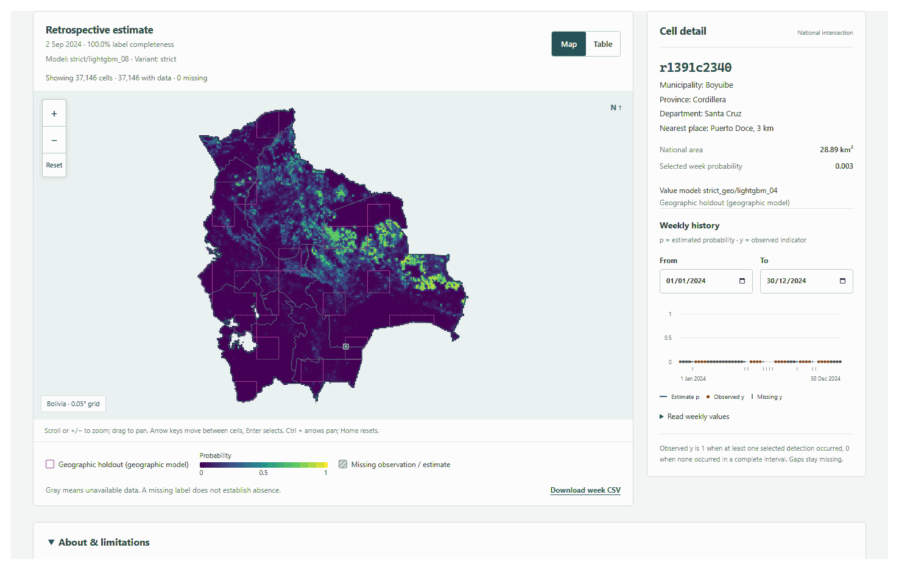

# Artifact API

Run from the repository root:

```powershell
uv sync --all-extras
uv run --no-sync uvicorn backend.app.main:app --host 127.0.0.1 --port 8765
uv run --no-sync pytest -q tests backend/tests -p no:cacheprovider
uv run --no-sync ruff check src tests backend
```

`BOLIVIA_FIRE_DATA_ROOT` selects a repository-shaped data root; it must contain
`configs/protocol.yaml`. The default is the repository root. The service reads
prepared artifacts locally. It does not fit models or fetch source data.
Restart after publishing new panel, prediction, evaluation, or boundary files.
Startup discovers files and caches grid, week coverage, metadata, evaluation
summaries, and boundaries. Boundaries must match the SHA256 pins in
`datasets/sources.yaml`; simplification uses 0.005 degrees in EPSG:4326 with
topology preservation. Department borders are simplified independently.

Requests use Arrow column projection and predicates. A layer or CSV contains at
most one issue's eligible cells. A series contains at most 700 weeks. No request
materializes the full panel. JSON null labels remain null; CSV nulls are empty.
`n_primary` remains the observed detection count even when the label is missing.
`cell_index` refers to the zero-based position in `/grid` arrays, ordered by cell ID.
Dates use exact `YYYY-MM-DD`; layer/export dates must be available issue dates.
Range endpoints are inclusive and must fall within the prepared date range.
Unknown parameters, repeated parameters, malformed IDs, invalid enums, and
invalid ranges receive 422. Missing predictions and unavailable metrics receive
404; missing panel/grid data receives 503. Unexpected failures return a generic
500 without exception text or filesystem paths.

`/weeks` accepts `start`, `end`, `offset` (default 0), and `limit` (default and
maximum 700). `outage` means a documented outage interval overlaps the target
week, including short outages. `target_low_coverage` is the separate zero-bbox
detection heuristic. `label_complete_share` is the fraction of non-null labels;
neither flag independently establishes label completeness. `target_complete`
is true when every panel row for the issue has a complete target observation
interval. A false value means there are unobserved target days: each target day
must have been acquired and have strictly less than six hours of documented
outages. The frontend uses this field for its missing-observation notice and
shows the low-coverage heuristic in a separate notice.

Prediction files are `artifacts/predictions/{variant}/{split}.parquet`, with
`cell_id`, `issue_date`, `model`, and `p`; `y` is optional and is not used to replace
panel observations. Model names match the producer's `strict/lightgbm` form.
Metadata lists available runs and model names. If `model` is omitted, the first
model in lexicographic order is used; this ordering does not rank model skill.
Without predictions, a series returns null probabilities and an estimate returns
404. `variant` defaults to `strict`. Known base variants and discovered run names
are accepted; filesystem paths are never constructed from request parameters.

Metrics return the prepared `artifacts/evaluation/{split}_{variant}.json`
unchanged. Only existing summaries are listed. Test summaries are hidden unless
`final_test_log.json` contains an opening timestamp matching the current protocol
SHA256. Prediction visibility does not open the final test or compute metrics.

GET responses have ETags and `Cache-Control: public, max-age=300, must-revalidate`;
matching `If-None-Match` receives 304. Health and errors use `no-store`. Gzip is
enabled for bodies of at least 1,000 bytes. CORS defaults to same-origin access.
`BOLIVIA_FIRE_CORS_ORIGINS` is a comma-separated list of explicit HTTP/HTTPS
origins, for example `http://localhost:5173`; wildcard origins are rejected.
Only GET/HEAD and the `If-None-Match` request header are allowed cross-origin.

When `frontend/dist/index.html` exists at startup, StaticFiles serves the built
frontend at `/`, with SPA fallback for extensionless routes. Unknown API routes,
missing asset filenames, encoded traversal, backslashes, and drive paths receive
404. OpenAPI is at `/api/v1/openapi.json` and interactive documentation is at
`/api/v1/docs`.

## Compact series index

```powershell
uv run --no-sync python -m backend.app.prepare
```

This optional offline step projects the panel to `cell_id`, `issue_date`,
`y_primary`, and `n_primary`, sorted by cell and date, with 8,192-row Parquet
groups. It writes `artifacts/serving/series.parquet` and a manifest atomically.
The directory is generated serving data. DuckDB uses two threads, a 512 MB
memory limit, and at most 4 GB of temporary spill storage. Preparation requires
60 GiB free to preserve a 55 GiB reserve. It verifies that inputs did not change
during the build.

Startup verifies the protocol, cell file, panel file, and index SHA256 hashes.
An absent, stale, or corrupt index is ignored and requests use the original
panel. Only series requests use this index; layers retain the panel's weekly
row-group layout. Restart the service after preparing the index.
`BOLIVIA_FIRE_DISABLE_SERVING=1` forces the unprepared path for comparison.

```powershell
uv run --no-sync python -m backend.benchmark --requests 50 --unprepared --output backend/measurements_unprepared.json
uv run --no-sync python -m backend.benchmark --requests 50 --output backend/measurements.json
```

The benchmark starts its own uvicorn process on an available loopback port,
waits for a successful health response, measures the actual uvicorn process RSS
(the Windows virtual-environment launcher has a separate PID), and stops that
server after the workload. It records full source snapshot IDs and workload
dates/cells in the JSON files.

## Geographic estimates

The strict export contains temporal `strict/` models and geographic `strict_geo/`
models in the same Parquet files. A temporal strict selection joins its matching
geographic model only for cells whose grid `geo_holdout` flag is true. Baselines
match by name; LightGBM matches the single exported geographic LightGBM. An absent
or ambiguous match remains unavailable. Explicit geographic selections retain
their own exported population.

Estimate layers add parallel `value_model` entries and a `geographic_model` identifier.
For issue 2024-09-02, `strict/lightgbm_08` supplies 29,506 temporal probabilities and
`strict_geo/lightgbm_04` supplies 7,640 held-out probabilities, for 37,146 values.
Held-out slots remain null when their geographic estimate is unavailable. Model
identity is null for an unavailable value. These display joins do not change
predictions, models, partitions, metrics or the frozen protocol.

A held-out cell's series under a temporal strict selection uses the geographic
model and returns that model identifier. Observations still come from the panel.
The CSV `model` column identifies each value's actual model; `variant` identifies
the requested export. A missing estimate has an empty model/value. The frontend's
CSV adds place columns; the API CSV retains its original columns.

## Geography and provenance

`GET /api/v1/grid` includes `geo_holdout`, municipality, province, nearest populated
place and distance, and up to three populated places per cell when the prepared
place table exists. Names use the original source spelling. Place arrays remain
aligned to the sorted cell grid. GeoNames supplies place names under CC BY 4.0;
geoBoundaries supplies ADM0 through ADM3 display boundaries.

`GET /api/v1/boundaries?level=0|1|2|3` returns pinned, simplified GeoJSON.
Cell assignment uses original geometry; simplification preserves topology.
Metadata and export comments retain source attribution and available protocol,
experiment, cell, place-table, panel, model and calibrator hashes.

## Recorded request costs

The observed-only compact-index workload in [measurements.json](../backend/measurements.json)
has 50 layers and 50 series over 37,146 cells and 678 weeks. Its layer p95 is
97.12 ms and series p95 is 105.41 ms; startup RSS is 184,893,440 bytes.
These measurements describe the recorded snapshot and workload, without the geographic join.

## Browser navigation



The four recorded issues are 2024-09-02, 2024-09-09, 2024-09-16 and 2024-09-23.
Each frame shows the selected Boyuibe cell, geographic holdout outlines, actual
value-model identity and its rendered 2024 history.

The [README](../README.md#screenshots) shows live estimate, detail, table, mobile
and Spanish views. [Frontend documentation](frontend.md#historical-views) shows
historical layers and the live track record; [figures](figures.md) lists media sources.
