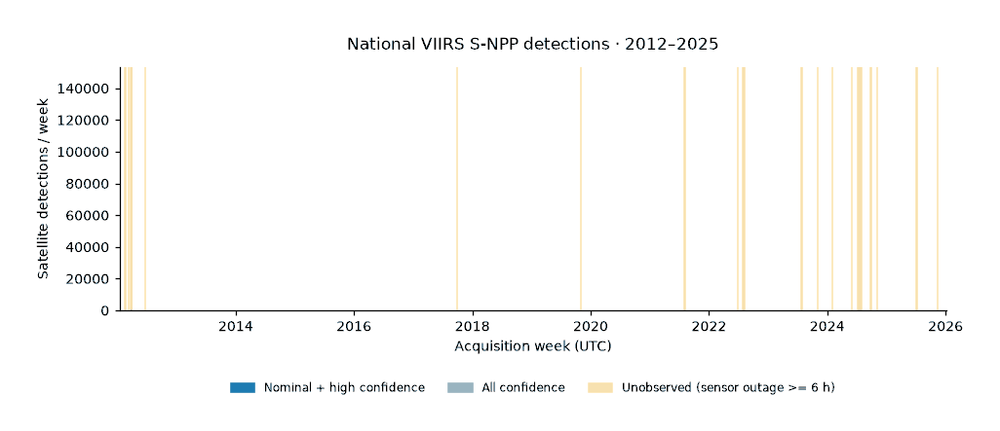
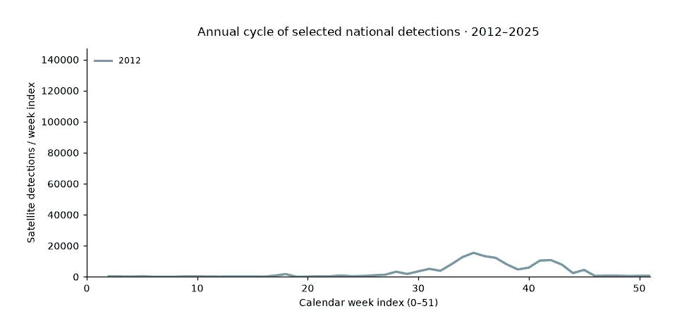
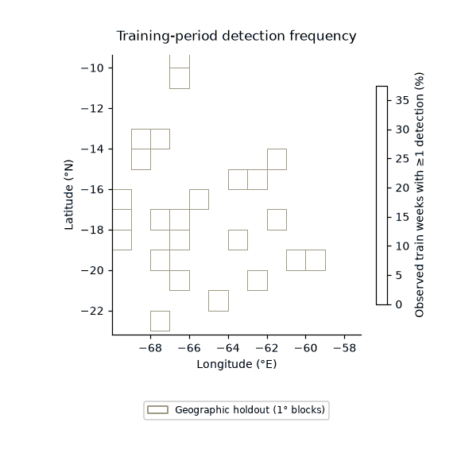

# Cell-week dataset

The frozen specification is `configs/protocol.yaml`. Builds use local,
hash-verified geoBoundaries pins and successful manifest-recorded FIRMS snapshots.
They make no network requests and do not require a FIRMS key.

```powershell
uv sync --all-extras
uv run bolivia-fire build cells
uv run bolivia-fire build detections
uv run bolivia-fire build panel --start-issue 2024-09-02 --end-issue 2024-09-09
uv run bolivia-fire explain-label r1345c2314 2024-09-02
uv run ruff check src tests
uv run pytest -q
```

Omitting the issue bounds builds every protocol Monday. Each selected year is
written one issue at a time to `datasets/processed/panel/year=YYYY/part.parquet`;
rebuilding a subset of a year replaces that year's file with the requested
issues. Other years are retained. A temporary Parquet file replaces each year's
destination only after all selected issues in that year have been written.

## Grid and provenance

`datasets/processed/cells.parquet` contains eligible 0.05-degree cells with edges
anchored at (-180, -90). Coordinates are rounded to 1e-9 degrees before floor
indices are computed; source coordinates have at most six decimals. The
tolerance is part of the grid contract. Cells use half-open snapped bounds. Only
positive-area intersections with ADM0 are eligible; corner and edge touches alone
are excluded. Areas use WGS84 geodesics on oriented polygon intersections,
including holes. Department assignment uses the largest national intersection
area, with department names sorted to resolve ties deterministically.

The pinned ADM0 polygon excludes large interior water and salt bodies. Its four
interior rings cover 10,875.19 km²; subtracting 94.64 km² of retained islands gives
a net exclusion of **10,780.55 km²**, verified from the hash-matching boundary
using oriented WGS84 geodesic areas. This exclusion contributes to the eligible
national area of **1,068,783.84 km²** being below the commonly cited
**1,098,581 km²**. The boundary's exterior geometry and area convention also
differ from that nominal figure; the interior exclusions do not explain the
entire difference. Area budgets use the eligible national intersections.

One-degree blocks use integer-degree edges and the full-cell center. Unique
eligible blocks are ranked by SHA256 of `20261031:{block_id}`; the first
`floor(0.2 * number_of_blocks)` are flagged `geo_holdout`. The flag persists
alongside temporal partitions. All fitting, selection, and calibration must
exclude these rows.

`datasets/interim/detection_bundles/BUILD_ID/detections.parquet` retains all bbox observations and selection
flags. Raw source fields are read as explicit strings and deduplicated across all
15 source columns before numeric conversion or HHMM normalization. Canonical
partitions require exact manifest-recorded product, bbox, start and day_range
identity. Missing or mismatching identity is rejected and reported in metadata
and statistics. Eligible partitions are chosen by descending day range, ascending start date, then
manifest order. Five-day chunks therefore take precedence over shorter chunks.
Fully covered partitions are skipped; partially covered partitions contribute
only uncovered UTC dates. The first remaining occurrence supplies provenance.
Each retained observation has its manifest-relative `source_file` and one-based
`source_line`, excluding the
header. The row can be recovered from the hash-recorded raw snapshot.

The manifest is read once and its exact bytes are hashed, so later concurrent
appends do not change the recorded input snapshot. Metadata records skipped and
partially excluded partitions with their expected hashes and excluded dates.
Only canonical source files are opened. Raw-file hash mismatches, path escapes,
invalid codes, invalid times, and invalid selected raw partitions abort the
build. Source dates and zero-padded times form UTC timestamps. ADM0 `covers`
includes boundary points; every bbox observation also
receives a grid ID, whether or not that cell is eligible. Primary selection is
type 0 with nominal/high confidence. All-confidence selection also includes low
confidence; neither selection changes the stored observation table.

Parquet metadata records the protocol file hash and source-pin file hash when
present. Detection and acquisition-day metadata also record the exact FIRMS
manifest snapshot hash, overlap exclusions, canonical selection rule, and
duplicate count. Panel metadata carries forward the detection manifest hash.
Panel metadata adds hashes of the exact cell, detection, and acquisition-day
inputs. Column definitions are in `datasets/schemas/{cells,detections,panel}.yaml`.

## Labels and missing data

`acquisition_days.parquet` in the same versioned bundle has one row for every date from
acquisition start through acquisition end, inclusive. Only hash-verified
`ok_rows` and `ok_empty` partitions establish acquisition. Counts describe
deduplicated bbox observations and observations covered by ADM0, across every
type and confidence.

Targets cover `[issue, issue+7 days)` and use only national observations.
`n_primary` and `n_allconf` count observed selected rows. `y_primary` and
`y_allconf` are nullable indicators: both are null if any target day is not observed.
Observed counts remain available for incomplete targets and do not establish a
complete negative label. `explain-label` prints the file and data-line references
behind the primary count, plus target completeness and the nullable label.

`target_low_coverage` flags any June-November target day with zero bbox
observations. This is a possible-outage heuristic, not evidence that an outage
occurred. It is independent of `target_complete`, including for successfully
acquired empty partitions.

Temporal partitions follow protocol issue-date bounds. A row is purged
(`partition` is null) when its target end is later than the next partition's
start. Equality is allowed because the target is half-open. The final test
partition retains December 29, 2025, whose target ends January 5, 2026.

## Features

Observation-derived features use primary national detections strictly before
Monday 00:00 UTC. Counts cover the previous 7, 14, 28, 91, and 365 UTC days.
The panel also contains a seven-day indicator, 28-day FRP sum, capped recency,
the count in `[issue-364 days, issue-357 days)`, national counts for 7/28 days,
centered 3x3 and 7x7 neighborhood counts for 7/28 days, and calendar-week-index sine/cosine.
Neighborhoods include the center cell and assign zero to cells outside
eligibility. National counts include covered boundary points even if their
assigned cells have no positive-area national intersection.

Recency is the number of UTC calendar days since the latest prior detection,
capped at 730. `no_prior_detection` distinguishes absence of any available prior
observation from a known observation older than the cap. Earlier cell presence
is read in batches, so retaining this distinction does not require a dense array
covering the entire acquisition period.

Daily count arrays use int16 where safe, otherwise int32; cumulative counts use
int32 or int64 according to the maximum per-cell total. Neighborhoods use raster
summed-area tables. FRP accumulation uses float64; numeric output features use
float32. Dense history covers the issue year plus 730 antecedent days, and output
is streamed by issue within each year.

Detection builds stage source strings in a disk-backed DuckDB database with a
512 MiB query memory limit and temporary spill storage. Exact deduplication is
performed before source parsing. Output is written in batches of at most 100,000
rows and promoted after completion. Temporary database files are removed after
the build.

`feature_window_complete` requires all 365 antecedent days to be acquired;
`window_complete_28d` requires all 28 days. Dates before acquisition start are
missing. Counts over incomplete history represent observed detections and must
be interpreted with these flags.

`train_climatology_cell` fits complete, non-purged training labels outside geographic
holdout. Its week index is `min((day_of_year-1)//7, 51)`. The feature is the pooled
arithmetic mean of labels at circular week offsets -2 through +2. Training-year
rows exclude their own year's labels; later years use all training years. This
is the protocol's cross-fitted training statistic, while the remaining history
features are computed directly from observations before the issue.
`train_climatology_dept` pools the same labels by department, giving each
non-held-out cell-week equal weight. Held-out cells receive department
climatology whenever their department has eligible history. Held-out labels
never contribute. With no eligible training labels, climatology is null.

The temporal test uses the full strict feature set and non-held-out cells. The
geographic test uses held-out cells in test years and `strict_geo` (excluding
`train_climatology_cell`), with department climatology as its baseline. Past
held-out detections remain eligible observation history.

## Verification

Synthetic tests cover grid-edge noise and half-open membership, largest-share
assignment, deterministic geographic holdout, HHMM padding, leap day and year
transition, exact deduplication and source lines, country exclusion, nullable
incomplete targets, partition purging, label explanation, circular climatology
and leave-one-year-out exclusion, capped known recency, boundary-only national
observations, and streamed panel output. Metamorphic tests delete or perturb
future observations and compare all observation-derived features; deleting
prior observations leaves target labels unchanged.

Canonical-selection tests cover longer-partition precedence, fully covered
partition exclusion, partial-overlap date filtering with original source-line
retention, and manifest-snapshot hashing. Measurements should be regenerated
after acquisition finishes; appending partitions changes the build input.

## Protocol 1.1 observation coverage and publication

The dated NASA MODAPS outage HTML and parsed UTC intervals are pinned by SHA256
in `datasets/sources.yaml`. Outage intervals are half-open; a single-date row
ending at 00:00 ends at the following midnight. Overlapping intervals contribute
their union, clipped to each UTC day. `observed = acquired and outage_hours < 6`.
This documents major sensor outages; it does not prove cloud-free observation.
Both target labels are null if any of seven target days is not observed.
`target_low_coverage` defines a sensitivity analysis excluding flagged rows,
not the primary missing-label rule.

History values remain available across outages. `window_obs_complete_28d` and
`window_obs_complete_365d` require every antecedent UTC day to be observed;
fitting requires the 28-day flag. The older `feature_window_complete` and
`window_complete_28d` columns describe acquisition only. Seasonality and
climatology share `w = min((day_of_year(issue)-1)//7, 51)`; seasonality uses
`2*pi*w/52`. Training-row climatology explicitly uses other train calendar years,
including later train years, and excludes all validation and test years.

Detection builds write detections and acquisition/observation days into a fresh
`datasets/interim/detection_bundles/BUILD_ID/` directory. They publish both by
atomically replacing `datasets/interim/detection_bundle.json` after both
files are complete. A failed build leaves the previous pointer usable. The
pointer records file hashes and manifest-snapshot, outage-snapshot and protocol
hashes. Panel construction resolves the pointer once, verifies hashes and
requires matching provenance on both files and the current protocol/outage pins.
Cells must have the same protocol hash. Legacy unbundled files are rejected.

While acquisition appends to the manifest, copy it and use
`build detections --manifest-snapshot PATH --output-dir DIRECTORY`. Run
`build cells --output-dir DIRECTORY` and `build panel --output-dir DIRECTORY`
with that same directory. These commands read local raw files and write no
acquisition data. Availability refers to the exact frozen manifest, not later
appends. Default output paths remain those documented above.

## Observed record



National weekly selected and all-confidence detections use the canonical detection bundle; shaded spans merge UTC days with at least six outage hours from its observation-day table.



Annual selected-detection cycles accumulate from the same canonical bundle using the protocol's 0?51 calendar index; endpoint-year coverage follows the acquisition window.



Training-period complete-label frequency and held-out blocks come from the prepared cell-week panel and pinned national boundary, as recorded in `artifacts/figures/dataset_summary.json`.

The [media specification](figures.md) lists sources, sizes, timing and verification.
