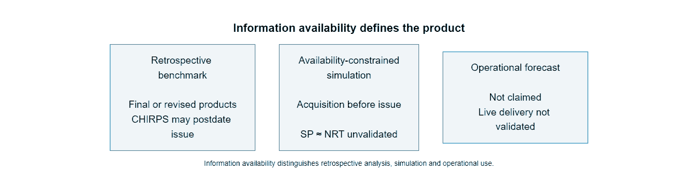
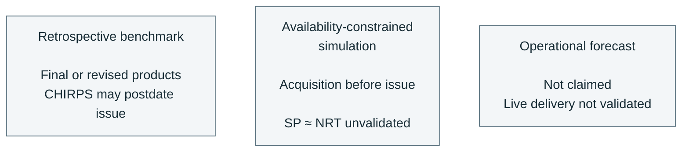

# Model fitting and evaluation

`configs/protocol.yaml` is the frozen contract. `configs/experiments.yaml` lists
the feature columns, ablation groups, seeds and bounded LightGBM search space.
The panel must already exist under `datasets/processed/panel/year=YYYY/part.parquet`.

```powershell
uv sync --all-extras
uv run --no-sync bolivia-fire train --variant strict
uv run --no-sync bolivia-fire select --variant strict
uv run --no-sync bolivia-fire evaluate --variant strict --open-final-test
uv run --no-sync bolivia-fire predict --variant strict --split test
```

`train` and `select` also fit and select the corresponding geographic feature set
(`strict_geo` or `retrospective_geo`). It excludes `train_climatology_cell`, retains
department climatology and uses the same seeded search. Geographic fitting still
excludes all held-out blocks. Its climatology baseline uses the department column.

`evaluate` defaults to the final test and refuses access without
`--open-final-test`. `--split val_select` and `--split val_calib` permit validation
reports without opening the test. Each test opening is appended to
`artifacts/evaluation/final_test_log.json` before test labels are loaded, including
failed attempts after that point. A second opening requires a nonempty
`--reopen-reason` and is flagged as a reopening. The entry records UTC time,
protocol/configuration hashes, panel snapshot, model and calibrator hashes,
environment, hardware and Git commit when available.

Use the same `--variant`, `--selection` and `--drop-group` options at every stage.
`--selection all_confidence` changes the target to `y_allconf` while keeping the
strict primary-selection history features. `--drop-group` accepts `neighborhood`,
`climatology` or `national` and removes those columns from both fitted models;
the two protocol baselines remain available for comparison. Separate run names
prevent these variants from overwriting the primary strict experiment.
`--exclude-low-coverage` excludes `target_low_coverage` rows at every stage as a
separate sensitivity run.

The retrospective list is frozen before fitting: `rain_sum_7d`, `rain_sum_30d`,
`rain_sum_90d`, `dry_days_30d` and `rain_anomaly_90d`. Model loading joins the
CHIRPS feature files by cell and issue date through `join_retrospective`. Product,
protocol, training reference years and manifest hashes must match their recorded
provenance. Feature files and the manifest enter the stage snapshot hashes.
The rain completeness and climatology flags gate eligible rows; they are not
additional model inputs. Every required value must be finite and every associated
flag true for the stage's eligible population. Missing or incomplete covariates,
invalid provenance, or a feature list adding nothing over strict prevent
retrospective training and selection. See `docs/covariates.md` for availability
constraints.

## Eligibility and loading

Fitting, selection, calibration and ordinary temporal evaluation require an
assigned temporal partition, a finite binary label, exclusion from geographic
holdout and a true `window_obs_complete_28d`. Geographic evaluation reverses only the
holdout condition. Incomplete 365-day history is retained together with the
`window_obs_complete_365d` feature. Acquisition-only completeness remains
descriptive; eligibility uses observation completeness. Column names are mapped
under `columns` in the configuration. Holdout rows never enter fitting, model
selection or isotonic calibration.

Exclusion counts are sequential: missing labels, wrong geographic membership,
then incomplete 28-day history. Purged rows are counted independently across the
panel using the partition column alone; they are never scanned for labels.
`scanned` includes those purged rows plus the requested temporal partition.
Missing climatology predictions are omitted from that baseline's metrics and
reported as `missing_probability`; paired intervals use the common finite
prediction support and report `paired_rows`.
When requested, low target coverage is excluded after those eligibility rules and
counted separately.

Parquet projections and partition predicates are applied before label batches
are materialized. Selection reads labels only from `val_select` and `val_calib`;
training reads `train` and the early-stopping partition `val_select`. Numeric
matrices are float32 memory maps, populated in batches of at most 100,000 rows.
Metadata uses Arrow tables. No full-panel pandas frame is constructed. Temporary
matrix directories are removed when their stage exits.

## Models and selection

The temporal climatology baseline uses `train_climatology_cell` directly, clipped to
`[1e-6, 1-1e-6]`. Persistence estimates the training positive frequency in recent
count bins `0`, `1`, `2–4`, `5+`; an empty bin uses the overall training frequency.

Logistic regression uses lbfgs with at most 1,000 iterations. Nonnegative numeric
features receive log1p; signed seasonal sine/cosine terms and boolean flags bypass
log1p. Every column is then imputed and standardized using means and scales fitted
on the complete eligible training population only. A wholly missing training
column uses zero for imputation; a column with negligible variance uses unit scale.
All positives and a seeded 10% sample of negatives are fitted. The negative
sample count is rounded up, and each sampled negative receives weight
`N_neg / sampled_count`, preserving the eligible negative population's total
weight even when its size is not divisible by ten. Positive weights are one.

LightGBM fits 20 distinct seeded configurations: leaves `{7,15,31,63}`, learning
rate `{0.03,0.06,0.1}`, minimum leaf size `{50,200,1000}`, feature fraction
`{0.7,0.85,1.0}`, L2 penalty `{0,1,10}`. Training uses all eligible rows, at most
400 boosting rounds, 30-round early stopping on `val_select` AP, 63 histogram
bins, four threads and deterministic column-wise construction.

`select` ranks configurations by **uncalibrated** `val_select` AP, retains the
best LightGBM configuration, and compares it with logistic regression. The best
baseline is chosen by the same validation criterion. Ties resolve by model name.
After the choice is closed, each of the four final candidates receives an
isotonic fit on `val_calib` only, with clipped
out-of-range predictions. Single-class or unavailable calibration predictions
retain the identity map and record the reason. The artifact reports calibrated
and uncalibrated metrics for final candidates on both validation partitions.
Other search configurations retain uncalibrated metrics and `not_selected`
calibration status. Metrics on `val_calib`
describe the calibration fit and are not an independent evaluation.

## Metrics

- **Average precision:** step-wise area under the precision-recall curve, grouping
  tied scores together, matching scikit-learn's AP definition.
- **Brier score:** mean squared probability error.
- **Log loss:** mean binary negative log likelihood; probabilities are clipped to
  `[1e-15,1-1e-15]` for logarithms only.
- **ROC-AUC:** probability that a positive outranks a negative, with half credit
  for ties.
- **ECE:** ten equal-frequency bins ordered by probability; weighted absolute
  gaps between bin mean probability and observed positive fraction. Subsets with
  fewer than ten observations use one bin per observation. A reliability table
  records bin mass, mean probability and positive fraction. Ties use stable input
  order. Bootstrap multiplicities may split a row's mass at a bin edge.
- **Recall at 5% and 10% area budgets:** rank cells within each issue date by
  probability, accumulate national cell area, include the crossing cell's
  positive contribution fractionally and pool selected positives over all weeks.
  Equal probabilities use the input row order. Subregion reports apply the
  budget to the eligible area of that subregion.

Empty subsets yield null metrics with `empty_subset` reasons. AP and ROC-AUC
are null for single-class subsets; area recall is null without positives.
Brier score, log loss and ECE remain defined for single-class subsets.

Each of the four final candidates (both baselines, logistic regression and the
selected LightGBM) receives calibrated and uncalibrated percentile intervals
from 500 seeded block-bootstrap replicates. Temporal resampling draws calendar
months with replacement; geographic evaluation draws one-degree blocks with
replacement. Each replicate uses identical multiplicities for a model and its
best-baseline comparator. Differences are model minus baseline, including for
losses where a negative difference favors the model. Undefined draws are omitted
per metric, with valid replicate counts reported. Area and positive contributions
both carry block multiplicity; temporal draws therefore repeat whole weeks.

H1 is supported only when the lower endpoint of the 95% paired month-block AP
difference interval for the calibrated strict winner versus the best uncalibrated
baseline is greater than zero. H2 is supported when the paired AP difference
interval for retrospective minus strict contains zero. Both decisions appear
under `hypotheses`; H2 is null with a reason until both matching selections exist
and genuinely additional, provenance-verified retrospective inputs are complete
for every evaluated row. Invalid retrospective comparison inputs never support
H2. Identical-input smoke runs are excluded from hypothesis decisions. A
retrospective final evaluation requires the strict selection to be closed first.
If the requested retrospective evaluation itself lacks valid inputs, its report
records `status: unavailable`, empty model metrics and null hypotheses with the
input failure reason. Final-test access is still logged before any label scan.
Comparisons use the same eligible cell-weeks and resamples. Validation reports
do not make final-test hypothesis decisions.
The primary baseline remains the original clipped climatology or empirical
persistence probability, chosen on `val_select`. Isotonic calibration of that
baseline is reported only as `calibrated_baseline_sensitivity`. All primary
candidate intervals use the original baseline as their comparator.

## Artifacts

`artifacts/models/<run>/run.json` records training eligibility and every model's
parameters. Joblib files store estimators, train-only transforms and calibrators.
Calibrators also have separately hashed files. Selection records explicitly pin
`experiments_sha256`, including the search space and seed.
Load only trusted local model files. `artifacts/evaluation/selection_<run>.json`
records all 23 candidate validation reports, the closed choice and model hashes.
`artifacts/evaluation/<split>_<run>.json` contains final candidate metrics,
reliability tables, per-year and Santa Cruz breakdowns, geographic holdout results,
bootstrap intervals and paired differences. The top-level `bootstrap` entry
references the calibrated selected candidate in each population.
`candidate_bootstrap.temporal` and `.geographic` cover the respective final
candidates and both probability versions.

Predictions are written to `artifacts/predictions/<run>/<split>.parquet` with
`cell_id`, `issue_date`, `model`, calibrated `p` and nullable `y`. Prediction
exports both geographic groups using their respective models, with the feature
set prefixed in `model`, and retains rows with missing labels while still
requiring 28-day feature completeness. It never computes test metrics. A JSON
sidecar records the prediction checksum and provenance.

Stage JSON artifacts record hashes of the exact input panel files and configs,
seed, package versions, Python version, Git commit when available, CPU, physical
RAM, process peak working set and elapsed runtime. Model choices require matching
training/validation snapshots and model hashes. Panel changes require retraining
and reselection. Test-only changes do not affect selection but appear in final
evaluation provenance. Writes promote completed temporary files atomically.

## Synthetic verification

```powershell
uv run --no-sync ruff check src tests
uv run --no-sync pytest -q
uv run --no-sync python tests/models/benchmark.py --rows 2000000 --report artifacts/synthetic_2m_benchmark.json
```

The benchmark constructs explicitly synthetic data in a temporary directory,
runs all four stages with the frozen search and bootstrap counts, records peak
RAM and phase runtimes, and removes its temporary dataset. It is a resource check,
not an estimate of real-world model skill or full-panel runtime.

## Information availability products



The three product definitions follow `configs/protocol.yaml` and the [information-availability contract](protocol.md#information-availability), including the unvalidated SP-to-NRT assumption and absence of an operational forecast claim.


