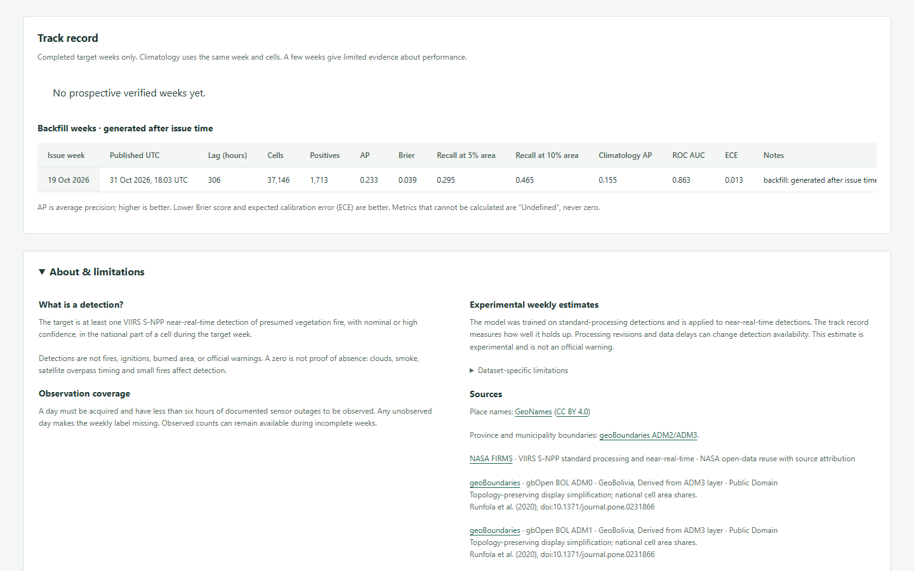

# Weekly detection explorer

The frontend uses Svelte 5, TypeScript, Vite 8 and Tailwind CSS 4. Node
22.12 or newer is required. The lockfile pins dependencies. The default build
uses same-origin `/api/v1` URLs; the static build reads relative data files.
Neither mode uses tile, map, font or chart services.

## Static hosting

Run the build from a `main` source checkout. Keep a separate sibling checkout
of `live-data`, which contains exported data rather than the application:

```powershell
git worktree add ../live-data origin/live-data
cd frontend
npm ci
$env:LIVE_DATA_DIR = '..\..\live-data'  # a checkout of the live-data branch
# PAGES_BASE optionally overrides the default root path: '/'
npm run build:static
npm run preview -- --mode static
```

The site is served at `https://bolivia-fire.cupesi.org/`. Open the preview at
its root URL. `PAGES_BASE` defaults to `/`; set it explicitly for subpath hosting.
Preview must use `--mode static` and the same
`PAGES_BASE` as the build. The default `npm run build` remains the API build.

The static build copies `index.json`, the grid, cell places,
ADM0/ADM1/ADM2/ADM3 boundaries, metadata,
the latest 52 issues' declared forecasts and observations, and the verification
CSV into `dist/data/`. It excludes model files, rolling state and Parquet files.
Missing declared weekly files fail the build; a missing verification CSV is
shown as an unavailable-file state. Place JSON at or above 5 MB and total data
above 200 MB fail the build. Initial JavaScript must remain below 39,338 bytes gzip for static builds
and 37,661 bytes for API builds.
When `model/model_card.json` is present, the build copies its model name into
the published metadata after checking that the model hashes match. Model
artifacts remain excluded from the distribution.

The initial layer is the latest issue's **Experimental weekly estimate
(near-real-time data)**. The page shows the issue, an inclusive target date
range in UTC, publication time to the minute, rounded publication lag in hours,
model variant/name with an eight-character hash, and the pre-issue input window.
The full hash is available in a tooltip and expandable forecast provenance,
alongside the exact half-open interval and original publication timestamp.
The week selector lists published forecast issues. Observations are
enabled only for complete target weeks; incomplete weeks retain missing labels.
Cell details show recent weekly probabilities, detection indicators and counts.
History requests are bounded to four issues at a time and cancel on selection
changes. Data files require a connection; offline failures have retry controls.

Target coverage uses the observation file and the catalog's `last_updated_utc`,
not the browser clock. Target dates on or after that UTC date are pending;
earlier dates listed as unobserved retain the protocol outage warning. An
informational progress note gives the last observed target day. This preserves
the snapshot's meaning when a page is viewed after publication. Input outages
have one neutral summary line and an expandable list of dates.

The model was trained on standard-processing detections and is applied to
near-real-time detections. The track record measures how well it holds up.
Verification tables report AP, Brier, recall at 5% and 10% area, same-week
climatology AP, ROC AUC and ECE, retaining undefined scores as missing.
Prospective rows and backfills have separate tables. The SVG performance chart
uses only `prospective=true` rows. A prospective forecast is generated by the
scheduled workflow within 24 hours after Monday 00:00 UTC; manual or later
publications are backfills. Publication lag remains visible in both groups.

Run the isolated static browser suite:

```powershell
Remove-Item Env:LIVE_DATA_DIR -ErrorAction SilentlyContinue
npm run test:e2e:static
```

The suite builds the explicitly synthetic four-cell fixture and starts Vite
preview at `http://127.0.0.1:4174/`. Chromium, Firefox and WebKit
use the shared host browser cache. The suite covers relative paths, forecast
metadata, week switching, observed layers, history, track-record groups,
backfill-only data, incomplete weeks, offline recovery and missing files.
Screenshots and JSON results are under `frontend/test-results/static/`.

For a real checkout, set `LIVE_DATA_DIR`, then run
`npm run test:e2e:static -- --grep @smoke --output=test-results/static-real`.
Set `STATIC_REPORT=test-results/static-real/results.json` to retain the
synthetic JSON report. The three smoke cases run in all three engines and
capture desktop and mobile screenshots without assuming a particular issue.

## API mode

```powershell
cd frontend
npm ci
npm run check
npm run test
npm run build
```

The build writes `frontend/dist`. Start or restart FastAPI after that directory
exists; its static mount is configured at startup. See [the API contract](api.md).

```powershell
uv run --no-sync uvicorn backend.app.main:app --host 0.0.0.0 --port 8765
```

For development, `npm run dev` serves port 5173 and proxies `/api` to
`http://127.0.0.1:8765`. The production page is served by FastAPI at port 8765.
`npm run test:api` checks the real local API, including bounded CSV export and
null labels. Set `API_BASE_URL` to change that script's origin.

## Data and interaction

The client uses the exact flat grid, paginated week catalog, model lists keyed
by variant, and columnar time series documented in `docs/api.md`. It loads up to
700 available issue weeks in pages of 100. Requests are cancelled when filters
change; values from a previous selection are cleared while loading. Missing
predictions, incompatible filters, empty responses and connection failures have
separate text states. Estimates are enabled only when metadata lists prepared
prediction layers and models; their label states that they are retrospective
model estimates, not operational forecasts.
The estimate panel displays the exact model identifier and API variant returned
with the loaded layer. The `strict` export includes both temporal models such as
`strict/lightgbm_08` and geographic models such as `strict_geo/lightgbm_04`;
temporal strict selections automatically join the matching geographic model on
held-out cells. For the selected LightGBM, these are `strict/lightgbm_08` and
`strict_geo/lightgbm_04`. The geographic model family matches the temporal
selection; an ambiguous or absent match stays unavailable. Thin purple outlines
mark held-out blocks. Pale purple means a held-out cell has no geographic estimate
for that week; gray remains ordinary missing data. Cell detail and CSV rows identify
the model producing each probability, and held-out history uses the same geographic model.

The missing-observation notice uses `/weeks.target_complete`, independently of
the `outage` flag for any documented overlap. Short outages can coexist with
complete labels. The zero-detection low-coverage heuristic has its own notice
and does not establish completeness. About text and source attributions cover
NASA FIRMS, geoBoundaries and CHIRPS; MapBiomas is absent from the acquired data.
Provenance uses curated labels, with shared protocol, cell and source hashes
shown once and year-specific panel identifiers available in an expandable view.
Only supplied provenance fields are rendered, including experiments, cell places,
model and calibrator hashes and the recorded final-test opening time.

Place names come from GeoNames (CC BY 4.0). Cell detail and hover tooltips show
the municipality, province, department, nearest populated place and rounded
distance in kilometres, and up to three populated places inside the cell.
Names retain their source accents. Static mode decodes the versioned string
dictionary in `static/cell_places.json` in exact grid order; the client also
accepts earlier flat exports. API mode reads the corresponding `/grid` columns.

The map raster has one pixel per eligible grid cell. Nearest-neighbor scaling
preserves cell blocks. It uses a north-up geographic projection with square
0.05-degree blocks; these do not represent equal ground area. Simplified national
and department outlines are always drawn on top. Province
(geoBoundaries ADM2) outlines appear at 2 times the fitted scale; thin, low-contrast
municipality (ADM3) outlines appear at 4 times. Town labels appear from 2 times
for populations of at least 20,000, deduplicated by GeoNames ID and positioned
at the containing cell centre. Labels are prioritized by population and rejected
when their measured boxes overlap or extend outside the map. Null or absent
values are
gray, complete negatives pale yellow, and detected positives teal. Probabilities
use an ordered viridis-like scale with a 0–1 legend. There is no interpolation
between cells and no conversion of missing labels to zero.

Map controls:

- Wheel or +/− buttons zoom; pointer drag pans.
- Focus the map and use arrow keys to move between eligible cells; Enter or
  Space selects. The first selection uses a central eligible cell.
- Ctrl + arrows pans; +/− zooms; Home resets the extent.
- Alt + left/right changes to the previous/next available issue week.

The selected cell retains its department and national area. The weekly history
has independent inclusive date bounds, limited to 700 weeks. The SVG chart
breaks probability paths at null values and marks missing observations below
the axis. An expandable table exposes the same weekly values as text.

The current-week table shows Cell, Municipality, Province, Department, Nearest
place with rounded distance, Area (km²), and Probability for estimates or
Detected (1/0) and Count for observations. Place text retains the source spelling
and accents. Text and headers align left; numeric cells and headers align right
with tabular numerals. Area uses two decimal places and probability uses three.
Province and nearest place move below municipality when the panel narrows;
department joins them on phones. The table fits a 390-pixel viewport without
horizontal scrolling.

The place filter matches municipality, province, department and nearest place,
ignoring case and accents without changing displayed names. Filtering precedes
Top 50, 100, 500 or all cells ranked by current value. Every column sorts that
subset, with missing values last and 25 rows per page. Headers and the sort
selector expose the direction, including when secondary columns are collapsed.
Clicking a row or pressing Enter on its cell button opens Cell detail; Up/Down
arrows move focus between rows. The selected row and keyboard focus remain visible.

Both modes generate the week CSV from the complete loaded layer, independently
of the place filter, Top N, sorting and pagination. Exports retain source numeric
precision, nulls as empty fields and provenance comments, adding municipality,
province, department, nearest-place name and distance, and national area. The
API endpoint remains available separately with its existing columns and per-cell model identity.

The layout uses two columns on desktop and stacked panels on narrow screens.
Native controls, visible focus, descriptive labels, a skip link, keyboard map
interaction and live status text provide alternatives to pointer interaction.
The canvas uses an application region for spatial keys, alongside the table.
There is no decorative animation.

## Historical views


Issue 2024-09-02 combines temporal and geographic estimates across 37,146 cells.
Purple outlines mark the held-out blocks. The selected Boyuibe cell identifies
`strict_geo/lightgbm_04` beside its probability and 2024 history.


Observed detection indicators for issue 2024-09-02, with positive and negative cells,
label completeness and the selected Boyuibe cell's weekly history.



The live snapshot separates backfill verification from prospective performance.
The 2026-10-19 result is a backfill; no prospective verified weeks are present.

## Browser tests

The interface supports English and Spanish.

After building the API frontend and starting the backend, run:

```powershell
cd frontend
$env:BASE_URL = 'http://127.0.0.1:8765'
npm run test:e2e -- --grep-invert 'capture ' --output=test-results/api
```

Use the production build for the language-loading checks, which inspect emitted
asset requests. The API suite covers layers, history, held-out provenance, unavailable
geographic estimates, place filtering, exports, keyboard interaction, recovery and
desktop/mobile layout in Chromium, Firefox and WebKit. The EN/ES buttons retain
native keyboard activation and pressed state. Their labels have spacing without a
text separator.

Use the static suite above for isolated synthetic coverage and the real-data smoke
suite for a live-data checkout. Capture commands and media sizes are in [figures](figures.md).

The [media inventory](media.md) lists screenshots and animations with their source issues,
languages, dimensions and sizes.
