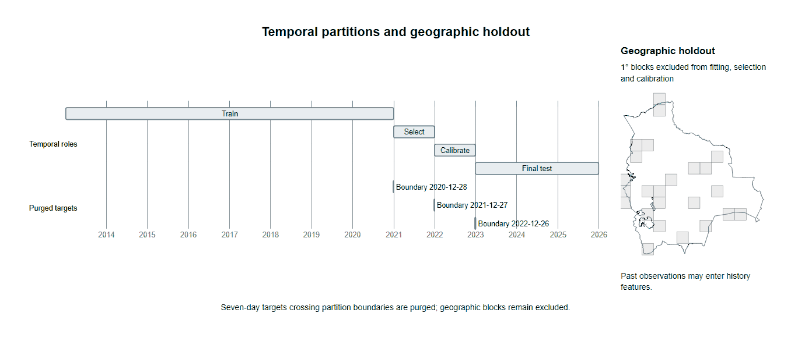
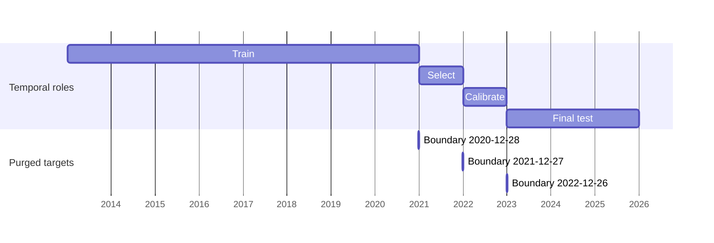

# Evaluation protocol

The machine-readable protocol is [`configs/protocol.yaml`](../configs/protocol.yaml). This page gives the
rationale. The protocol was frozen on 2026-10-31, before any model was fitted.

## Question

How much skill remains over training-only climatology and persistence when forecasting next-week
satellite fire detections in Bolivia on future years and on geographic regions excluded from fitting,
and how much of any apparent gain depends on covariates whose historical versions were not available
at forecast issue time?

Two hypotheses are tested, and either may be rejected:

- **H1.** A model using only information available at issue time (strict variant) improves average
  precision over the better of climatology and persistence on the 2023–2025 test years.
- **H2.** Adding retrospective covariates (CHIRPS v3 rainfall, MapBiomas land cover) changes test
  average precision by less than the block-bootstrap uncertainty of the strict model.

## Target

For a 0.05° cell and an issue time `t` (Monday 00:00 UTC), the target is 1 when at least one selected
VIIRS S-NPP standard-processing detection falls in the national part of the cell during
`[t, t + 7 days)`. The target measures detections, not fires, ignitions, burned area, or official
warnings. A zero means that no selected detection occurred in a fully observed interval; it does not
prove that no fire burned (clouds, smoke, overpass timing and small fires all reduce detection).
Intervals with any unobserved day have a missing label, never a zero.

Selection: `type = 0` (presumed vegetation fire) and confidence nominal or high. A sensitivity
analysis repeats the main evaluation with all confidence classes. FIRMS confidence classes are
detection-quality categories, not calibrated probabilities.

## Spatial unit

Coordinates are rounded to 1e-9 degrees before computing floor indices; source coordinates have at most six decimal places. Half-open membership applies to these snapped coordinates.

Cells have edges at multiples of 0.05° in WGS84 and are closed on the west and south edges. A cell is
eligible when it intersects the geoBoundaries ADM0 polygon of Bolivia with positive area. Cells are
not equal-area: each cell carries the geodesic area of its national part, and every territorial
quantity (area budgets, maps of coverage) is area-weighted. Detections outside the national polygon
are excluded from labels and features even when they fall in a border cell.

## Information availability

Three products are kept separate:

1. **Retrospective benchmark** — may use final or revised products regardless of release date.
2. **Availability-constrained simulation (strict)** — uses only FIRMS-derived features computed from
   detections acquired before `t`. Its one stated assumption is that the standard-processing (SP)
   detections used here approximate the near-real-time (NRT) detections an operational user would
   have had at `t`. The archive offers no overlap period to quantify that difference, so it is a
   limitation, not a validated equivalence.
3. **Operational forecast** — not claimed by this project.

CHIRPS v3 and MapBiomas collections were released after most of the study period and revise their
full history, so lagging them does not recreate what was known at `t`. The fitted retrospective
variant includes CHIRPS rainfall. MapBiomas was omitted after verified anonymous raster access
failed; no MapBiomas inputs occur in the fitted models.

## Partitions

The timeline uses `configs/protocol.yaml` and the panel issue calendar; the inset uses the recorded cell holdout flags and pinned national boundary.

Timeline source

| Partition | Issue dates | Use |
|---|---|---|
| train | 2013-01-07 – 2020-12-31 | fitting |
| val_select | 2021 | model selection, early stopping |
| val_calib | 2022 | isotonic calibration only |
| test | 2023–2025 | final evaluation, opened once |

Rows whose target interval crosses into the next partition are purged. Twenty percent of 1° blocks,
chosen by a seeded hash, are excluded from all fitting, selection and calibration; they form a
spatiotemporal test on the test years. Santa Cruz department is reported separately.

## Models and selection

Baselines: training-only climatology per cell and calendar week index (department-pooled for the
geographic test; leave-one-year-out for training rows) and persistence (conditional detection frequency given recent detections). Candidates: logistic
regression and LightGBM, with a 20-configuration random search scored by average precision on
`val_select`. No neural models are planned unless these results justify them.

## Metrics and uncertainty

Primary: average precision over all eligible cell-weeks. Secondary: Brier score, log loss, ROC-AUC,
expected calibration error (10 equal-frequency bins), and recall at 5% and 10% area budgets (per week, cells are taken in order
of predicted probability until their national area reaches the budget share of the report population's national cell area). Confidence
intervals use block bootstraps over calendar months (temporal test) and over 1° blocks (geographic
test). Metrics undefined on a subset are reported as missing with the reason.

## Final-test access

Test metrics are produced only by the evaluation command with an explicit open flag, and each opening
is logged with selected model, calibrator, panel snapshot, protocol and experiments SHA256 hashes in `artifacts/evaluation/final_test_log.json`.

## Amendments

### 2026-10-31: protocol 1.1

Reason: independent review V1 before any model fitting. No model has been fitted.

- **A1 Observation coverage.** Pin the dated [NASA MODAPS S-NPP outage table](https://modaps.modaps.eosdis.nasa.gov/services/production/outages_suomi_npp.html)
  and its SHA256 in `datasets/sources.yaml`; parse UTC start/end into
  `datasets/manifests/snpp_outages.csv`. Intervals are half-open; overlapping outages
  contribute their union, with daily clipping at UTC midnight. A day is observed
  iff acquired and documented outages cover strictly less than six hours.
  Any unobserved target day nulls both labels. History values remain available
  with `window_obs_complete_28d` and `window_obs_complete_365d`; fitting requires
  the 28-day observation flag. `target_low_coverage` remains a zero-detection
  heuristic; excluding flagged rows is a sensitivity analysis, not the primary rule.
- **A2 Request identity.** Canonical selection and orphan recovery require exact
  product, bbox, start and day_range identity recorded in a manifest. Missing or
  mismatching identity is rejected and reported; filenames supply no evidence.
  New snapshots are namespaced by product and bbox. Recovery uses the durable
  request-identity manifest written before raw publication.
- **A3 Geographic climatology.** `train_climatology_cell` pools complete,
  non-purged train labels by cell and week. `train_climatology_dept` pools them by
  department and week over non-held-out cells, equally weighted per cell-week.
  Both smooth circular week offsets -2..2 and apply LOYO for train rows.
  The temporal test uses the full strict feature set on non-held-out cells.
  The geographic test uses `strict_geo`, fitted with the same procedure but
  excluding `train_climatology_cell`; its climatology baseline is
  `train_climatology_dept`. Past detections in held-out cells may contribute
  recency, neighborhood and national features because they are observations
  available at issue time. Held-out labels never enter fitting, selection,
  calibration or either climatology.
- **A4 Calendar.** Climatology and seasonality share
  `w = min((day_of_year(issue)-1)//7, 51)` and sine/cosine angle `2*pi*w/52`.
  December 24 and December 31, 2018 both use index 51. LOYO is an explicit
  cross-fitting exception: train-row climatology uses other train calendar years,
  including later train years, and never validation or test years.
- **A5 Grid snapping.** Round coordinates to 1e-9 degrees before floor. This
  tolerance is part of the grid contract; source coordinates have at most six
  decimals. Geographic holdout retains SHA256 ranking of unique 1-degree blocks
  and the lowest `floor(0.2 * block_count)` blocks.
- **A6 Decision rules.** ECE uses 10 equal-frequency bins. H1 is supported iff
  the 95% paired calendar-month-block bootstrap CI for temporal-test
  `AP(best strict candidate, calibrated) - AP(best baseline)` lies entirely
  above zero. H2 is supported iff the corresponding paired 95% CI for
  `AP(retrospective) - AP(strict)` contains zero. Best candidates and baselines
  are selected on `val_select` only. Temporal test means non-held-out cells;
  geographic test means held-out cells in test years. Regional area-budget
  denominators sum national area of that region's eligible cells that week.
  LightGBM search space and seeds are frozen in `configs/experiments.yaml`;
  its SHA256 is recorded at selection. Final test opens once; the access log
  records selected model files, calibrators, panel snapshot, protocol and
  experiments config SHA256 hashes. A second opening requires
  `--reopen-reason` and must be reported as a reopening.
