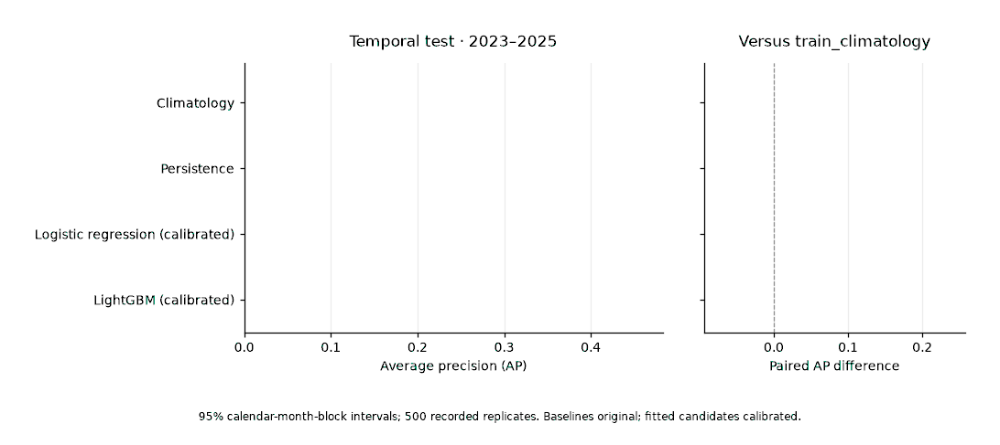
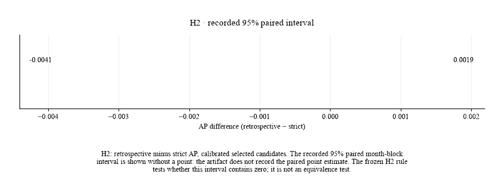
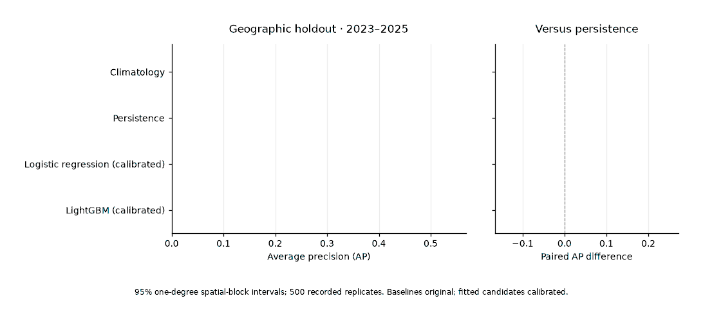
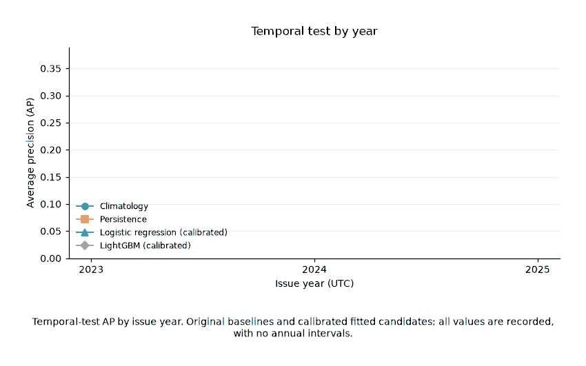
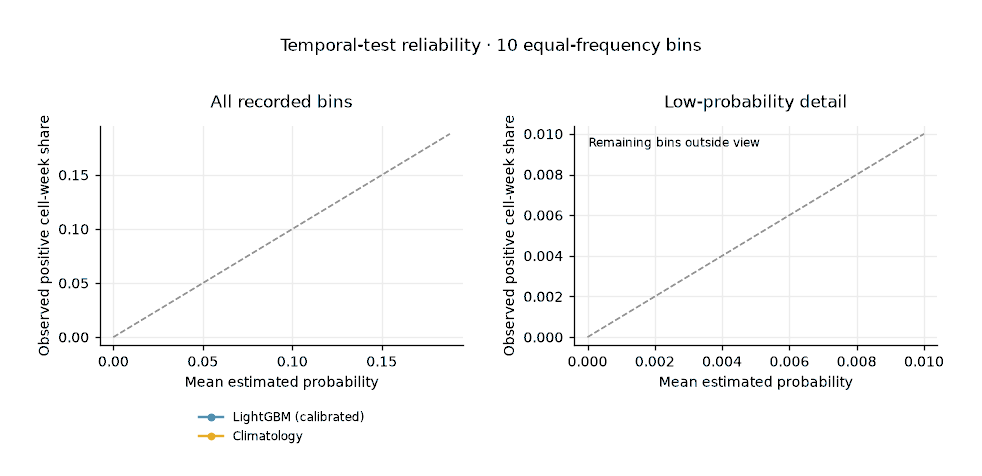
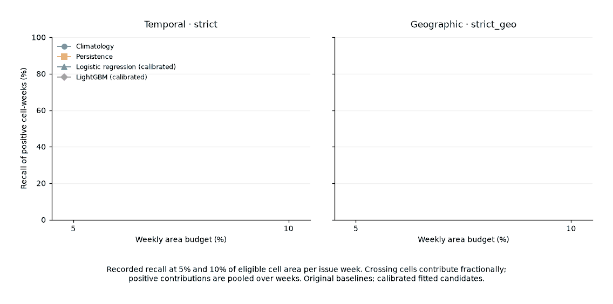
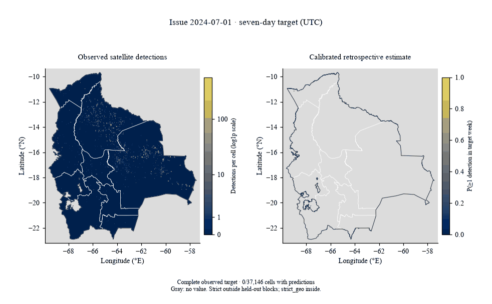

# Evaluation results

The primary final-test opening was `2026-10-31T10:30:00.578581+00:00`, recorded with `reopening: false` in
[final_test_log.json](../artifacts/evaluation/final_test_log.json). Later sensitivity openings
are logged separately with their reasons; they do not replace the primary results below.

Measured values come from [test_strict.json](../artifacts/evaluation/test_strict.json), the
[closed selections](../artifacts/evaluation/selection_strict.json), and
[results_summary.json](../artifacts/figures/results_summary.json). Metrics and interval endpoints
are rounded to three decimals; ECE and values below 0.001 retain two significant digits.
Counts are exact. Exact metric values are in the cited evaluation JSON artifacts.
AP means average precision over eligible
cell-weeks, rather than a mean of annual scores.

## Protocol and comparator

The [frozen protocol](../configs/protocol.yaml) defines a weekly binary target: at least one
selected VIIRS S-NPP standard-processing vegetation-fire detection in the national portion of a
cell. Primary labels use nominal or high confidence. Incomplete target weeks have null labels;
ordinary eligibility also requires complete recent observation history.

Model choice and early stopping use `val_select`; isotonic calibration uses `val_calib` only.
The best baseline and fitted candidate are selected by **uncalibrated validation AP**. Primary
test comparisons use **uncalibrated baselines versus calibrated candidates**. Calibrated-baseline
comparisons are a separate sensitivity result, not the primary comparator.

The temporal winner is `strict/lightgbm_08` and its comparator is
`train_climatology`; the geographic winner is `strict_geo/lightgbm_04` and its
comparator is `persistence`. These choices were closed in
[selection_strict.json](../artifacts/evaluation/selection_strict.json) and
[selection_strict_geo.json](../artifacts/evaluation/selection_strict_geo.json).

The test issue years are 2023-2025.
Temporal intervals resample the 28 represented calendar-month blocks;
geographic intervals resample 24 represented one-degree blocks.
Both use 500 seeded replicates and 95% percentile intervals.
Paired comparisons use the same rows and block multiplicities. Source:
[test_strict.json](../artifacts/evaluation/test_strict.json), `bootstrap` and `candidate_bootstrap`.

## Temporal test

The temporal population contains 3,127,636 eligible cell-weeks outside held-out blocks.
The table follows the primary probability rule above; losses and ECE are better when smaller.

| Model (probabilities) | AP [95% CI] | Brier | Log loss | ROC-AUC | ECE |
|---|---|---|---|---|---|
| `train_climatology` (uncalibrated) | 0.167 [0.105, 0.214] | 0.018 | 0.108 | 0.830 | 0.0070 |
| `persistence` (uncalibrated) | 0.143 [0.085, 0.187] | 0.017 | 0.083 | 0.648 | 0.011 |
| `logistic_regression` (calibrated) | 0.293 [0.195, 0.353] | 0.016 | 0.064 | 0.923 | 0.0039 |
| `lightgbm_08` (calibrated) | 0.323 [0.222, 0.383] | 0.016 | 0.062 | 0.928 | 0.0031 |

Source: [test_strict.json](../artifacts/evaluation/test_strict.json), `models` and
`candidate_bootstrap.temporal`; the AP values and intervals are also copied in
[results_summary.json](../artifacts/figures/results_summary.json), `figures.temporal`.

Temporal-test AP and paired intervals reveal the recorded models from `artifacts/evaluation/test_strict.json`; the best baseline remains validation-selected.

## H1 and H2

| Hypothesis | Paired AP comparison | 95% interval | Frozen decision |
|---|---|---|---|
| H1 | Calibrated strict winner minus uncalibrated climatology | [0.100, 0.218] | Supported: interval entirely above zero |
| H2 | Calibrated retrospective winner minus calibrated strict winner | [-0.004, 0.002] | Supported: interval contains zero |

H1's recorded AP difference is 0.157,
derived in the figure summary by subtracting recorded APs on identical support. H2 compares
`retrospective/lightgbm_16` with `strict/lightgbm_08` on
3,127,636 paired rows. Its point estimate is
not recorded, so only the interval is reported. H2's rule is not an equivalence test and does not
establish an absence of useful rainfall information. The retrospective addition is CHIRPS
rainfall; the selected feature list contains no MapBiomas inputs.

Sources: [test_strict.json](../artifacts/evaluation/test_strict.json), `hypotheses` and
`strict_retrospective_bootstrap`;
[selection_retrospective.json](../artifacts/evaluation/selection_retrospective.json), `features`;
[results_summary.json](../artifacts/figures/results_summary.json), `figures.temporal` and `figures.h2`.

The H2 animation shows the recorded paired interval from `strict_retrospective_bootstrap`; it supplies no unrecorded point estimate.

## Geographic holdout

The geographic test contains 809,840 eligible cell-weeks in blocks excluded
from fitting, selection and calibration. It uses `strict_geo`, which removes cell climatology
and retains department climatology. Historical detections from held-out locations may still
contribute history features under the frozen information rule.

| Model (probabilities) | AP [95% CI] | Brier | Log loss | ROC-AUC | ECE |
|---|---|---|---|---|---|
| `train_climatology` (uncalibrated) | 0.071 [0.031, 0.135] | 0.013 | 0.061 | 0.850 | 0.0023 |
| `persistence` (uncalibrated) | 0.181 [0.102, 0.243] | 0.012 | 0.062 | 0.672 | 0.0096 |
| `logistic_regression` (calibrated) | 0.351 [0.218, 0.436] | 0.011 | 0.046 | 0.940 | 0.0028 |
| `lightgbm_04` (calibrated) | 0.384 [0.250, 0.468] | 0.011 | 0.043 | 0.944 | 0.00092 |

The calibrated geographic winner's paired AP-gain interval against uncalibrated persistence is
[0.145, 0.233].
This population differs from the temporal test, so its higher AP is not evidence that spatial
transfer is easier.

Source: [test_strict.json](../artifacts/evaluation/test_strict.json), `geographic_holdout` and
`candidate_bootstrap.geographic`; [results_summary.json](../artifacts/figures/results_summary.json),
`figures.geographic`.

Geographic AP and paired intervals use the recorded strict_geo population and spatial-block intervals in `artifacts/evaluation/test_strict.json`.

## Per-year results and Santa Cruz

Annual temporal AP uses the same models and probability versions as the pooled temporal table;
no model is reselected within a year.

| Issue year | Eligible rows | Climatology AP | Persistence AP | Logistic AP | LightGBM AP |
|---|---|---|---|---|---|
| 2023 | 1,239,252 | 0.209 | 0.156 | 0.332 | 0.347 |
| 2024 | 678,638 | 0.100 | 0.208 | 0.319 | 0.374 |
| 2025 | 1,209,746 | 0.166 | 0.084 | 0.229 | 0.246 |

Santa Cruz contains 1,095,934 eligible temporal-test
cell-weeks. Its area-budget denominator is the eligible national cell area within the department
for each issue week.

| Model (probabilities) | AP | Brier | ECE | Recall at 5% area | Recall at 10% area |
|---|---|---|---|---|---|
| `train_climatology` (uncalibrated) | 0.161 | 0.022 | 0.012 | 0.216 | 0.353 |
| `persistence` (uncalibrated) | 0.202 | 0.020 | 0.013 | 0.295 | 0.367 |
| `logistic_regression` (calibrated) | 0.333 | 0.019 | 0.0045 | 0.373 | 0.558 |
| `lightgbm_08` (calibrated) | 0.381 | 0.018 | 0.0038 | 0.388 | 0.573 |

Source: [test_strict.json](../artifacts/evaluation/test_strict.json), `per_year` and `santa_cruz`.
Annual differences reflect the evaluated populations, including observation exclusions; the
artifact supplies no annual or Santa Cruz bootstrap intervals. The temporal comparator remains
the validation-selected climatology even where another baseline scores higher in a subset.

Annual AP uses the three recorded issue-year subsets in `artifacts/evaluation/test_strict.json`, with no annual model reselection.

## Calibration

ECE uses ten equal-frequency bins under the [protocol](../configs/protocol.yaml). The following
values compare each model before and after isotonic calibration. Baseline calibration is shown
for sensitivity only; primary baseline comparisons retain their original probabilities.

| Population and model | ECE uncalibrated | ECE calibrated |
|---|---|---|
| Temporal: `train_climatology` | 0.0070 | 0.0088 |
| Temporal: `persistence` | 0.011 | 0.010 |
| Temporal: `logistic_regression` | 0.0023 | 0.0039 |
| Temporal: `lightgbm_08` | 0.0040 | 0.0031 |
| Geographic: `train_climatology` | 0.0023 | 0.0067 |
| Geographic: `persistence` | 0.0096 | 0.010 |
| Geographic: `logistic_regression` | 0.0028 | 0.0028 |
| Geographic: `lightgbm_04` | 0.010 | 0.00092 |

Calibration lowers the selected LightGBM's pooled ECE in both populations, but does not improve
every model or every annual subset. In particular, temporal logistic-regression ECE increases.
Calibration is fitted only on the calibration partition; these test values do not guide fitting.

Source: [test_strict.json](../artifacts/evaluation/test_strict.json), `models` and
`geographic_holdout.models`; plotted reliability-bin values are copied in
[results_summary.json](../artifacts/figures/results_summary.json), `figures.reliability`.

The reliability figure uses the temporal test population only; its second panel
zooms into low predicted probabilities.

Recorded temporal reliability bins accumulate from `artifacts/evaluation/test_strict.json`; the detail panel omits bins outside its stated range.

## Recall at area budgets

For each issue week, cells are ranked by probability and accumulated to the budget share of the
eligible population's national cell area. The crossing cell contributes fractionally; selected
positive contributions are pooled across weeks. Equal probabilities follow input row order.
These are shares of positive cell-weeks captured, not shares of detected fires or burned area.

| Population and model (probabilities) | Recall at 5% area | Recall at 10% area |
|---|---|---|
| Temporal: `train_climatology` (uncalibrated) | 0.251 | 0.397 |
| Temporal: `persistence` (uncalibrated) | 0.265 | 0.323 |
| Temporal: `logistic_regression` (calibrated) | 0.370 | 0.545 |
| Temporal: `lightgbm_08` (calibrated) | 0.384 | 0.558 |
| Geographic: `train_climatology` (uncalibrated) | 0.104 | 0.122 |
| Geographic: `persistence` (uncalibrated) | 0.300 | 0.361 |
| Geographic: `logistic_regression` (calibrated) | 0.453 | 0.651 |
| Geographic: `lightgbm_04` (calibrated) | 0.469 | 0.673 |

Source: [test_strict.json](../artifacts/evaluation/test_strict.json),
`recall_at_area_budget_5pct` and `recall_at_area_budget_10pct` in each population;
[results_summary.json](../artifacts/figures/results_summary.json), `figures.area_budget`.

Area-budget recall uses the recorded temporal and geographic summaries in `artifacts/evaluation/test_strict.json` at 5% and 10% of eligible area.

## Example spatial distribution

The map is a descriptive example for issue `2024-09-02`, with target ending
`2024-09-09` (exclusive). It was chosen as the largest observed
detection total among complete target weeks in the example year with national prediction
coverage; ties choose the earliest issue date. Predictions use the strict model outside held-out
blocks and the geographic model inside them. The observed panel displays satellite detections,
not fire-event counts. This selected example is not an additional performance test.

Source: [results_summary.json](../artifacts/figures/results_summary.json), `figures.map`, including
the recorded selection rule, input provenance and figure caption.

The July–October 2024 map sequence joins the strict test prediction export to panel observations, retaining partial counts, null labels and unavailable estimates.

## Exclusions

Counts follow the sequential eligibility filters. `Wrong geography` means held-out rows for
fitting and temporal evaluation, and non-held-out rows for geographic evaluation. `Purged` is an
independent count across the panel, repeated in each report; `Scanned` includes that count and
the requested partition. Do not sum these repeated counts across partitions.

| Population | Scanned | Purged | Missing label | Wrong geography | Incomplete recent history | Eligible |
|---|---|---|---|---|---|---|
| train | 15,564,174 | 111,438 | 74,292 | 3,162,960 | 236,048 | 11,979,436 |
| val_select | 2,005,884 | 111,438 | 37,146 | 382,000 | 118,024 | 1,357,276 |
| val_calib | 2,005,884 | 111,438 | 148,584 | 359,080 | 206,542 | 1,180,240 |
| Temporal test | 5,943,360 | 111,438 | 557,190 | 1,084,880 | 1,062,216 | 3,127,636 |
| Geographic test | 5,943,360 | 111,438 | 557,190 | 4,189,852 | 275,040 | 809,840 |

The primary run has `exclude_low_coverage: false`; its `target_low_coverage` exclusion counter
is 0, which reports no exclusion by that optional filter,
not absence of flagged weeks. All primary table models report
0 missing probabilities on their
eligible populations. Paired temporal and geographic comparisons contain
3,127,636 and 809,840
rows respectively.

Sources: [selection_strict.json](../artifacts/evaluation/selection_strict.json), `exclusions`;
[selection_strict_geo.json](../artifacts/evaluation/selection_strict_geo.json), matching fitting
and validation eligibility; [test_strict.json](../artifacts/evaluation/test_strict.json),
`exclusions`, model `missing_probability` and bootstrap `paired_rows`.

## Sensitivity analyses

All pre-registered sensitivity analyses are published below. Each was evaluated as a logged
reopening after the frozen primary opening, with `reopening: true` and its recorded reason in
[final_test_log.json](../artifacts/evaluation/final_test_log.json).

All-confidence targets retain primary-selection history features. The ablations remove
neighborhood history, cell and department climatology, or national activity features,
respectively. Each run includes its corresponding geographic feature set under the same
validation selection and calibration procedure. The temporal protocol comparator is the
validation-selected, **uncalibrated `train_climatology`** in every run; differences below subtract
its AP from the calibrated selected model's AP on paired rows.

| Run and source report | Selected temporal model | Calibrated temporal AP [95% CI] | Paired AP difference vs protocol comparator [95% CI] | H1 decision | Calibrated geographic-holdout AP [95% CI] (selected model) |
|---|---|---|---|---|---|
| [All confidence classes](../artifacts/evaluation/test_strict_all_confidence.json) | `lightgbm_03` | 0.332 [0.229, 0.391] | 0.162 [0.106, 0.222] | Supported | 0.385 [0.251, 0.473] (`lightgbm_04`) |
| [Excluding low-coverage target weeks](../artifacts/evaluation/test_strict_exclude_low_coverage.json) | `lightgbm_08` | 0.323 [0.222, 0.383] | 0.157 [0.100, 0.218] | Supported | 0.384 [0.250, 0.468] (`lightgbm_04`) |
| [Without neighborhood features](../artifacts/evaluation/test_strict_drop_neighborhood.json) | `lightgbm_03` | 0.310 [0.216, 0.364] | 0.143 [0.095, 0.198] | Supported | 0.348 [0.214, 0.438] (`lightgbm_04`) |
| [Without climatology features](../artifacts/evaluation/test_strict_drop_climatology.json) | `lightgbm_03` | 0.316 [0.215, 0.375] | 0.149 [0.091, 0.221] | Supported | 0.387 [0.252, 0.472] (`lightgbm_03`) |
| [Without national activity features](../artifacts/evaluation/test_strict_drop_national.json) | `lightgbm_14` | 0.327 [0.228, 0.386] | 0.160 [0.106, 0.221] | Supported | 0.389 [0.252, 0.476] (`lightgbm_04`) |

Sources are linked by run: `selected_model`, `best_baseline`, `models`, `bootstrap`,
`hypotheses.H1` and `geographic_holdout`. Point differences subtract the recorded APs;
difference intervals are the recorded paired bootstrap intervals. H1 remains supported in each run
because its paired interval lies entirely above zero. The all-confidence run changes the
target definition, so its AP is not a performance gain on the primary target.

The low-coverage run equals the primary result because the evaluated test rows contain zero
low-coverage-flagged target weeks: `exclusions.test.target_low_coverage` and
`exclusions.geographic_holdout.target_low_coverage` both record 0 exclusions, leaving
3,127,636 temporal and 809,840 geographic cell-weeks. Its selected-model APs, intervals and
paired baseline comparisons match the primary evaluation. Source:
[test_strict_exclude_low_coverage.json](../artifacts/evaluation/test_strict_exclude_low_coverage.json),
`exclusions`, `models`, `geographic_holdout` and `bootstrap`.

Relative to the primary AP reproduced by the low-coverage run, temporal AP changes by
-0.013 without neighborhood features, -0.007 without climatology features and +0.004
without national activity features, calculated from the linked reports' calibrated APs.
Their AP and comparator-gain intervals are shown above; no paired ablation-minus-primary
intervals are recorded. These point changes measure predictive performance after feature
removal and validation selection, not causal effects, and do not establish a reliable ordering
of feature contributions.

The calibrated-baseline sensitivity remains separate in
[test_strict.json](../artifacts/evaluation/test_strict.json) under
`calibrated_baseline_sensitivity`. Primary tables and figures above describe the original
primary report.
